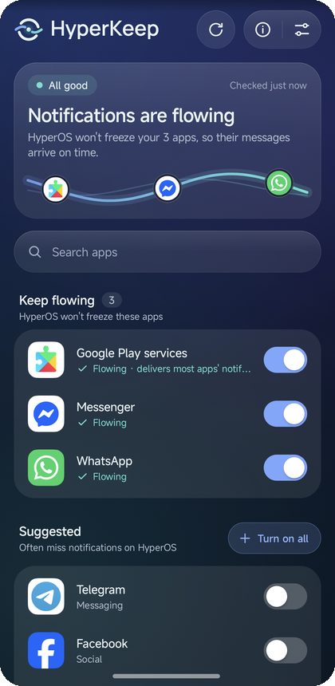
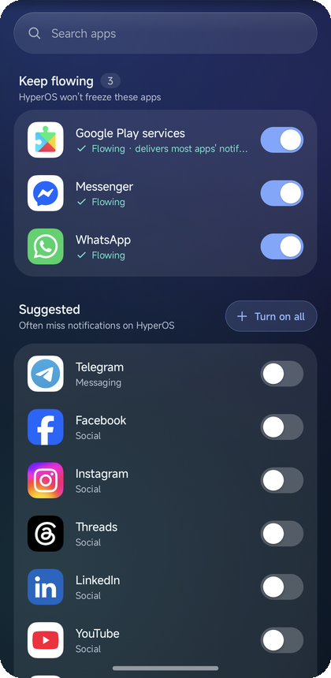
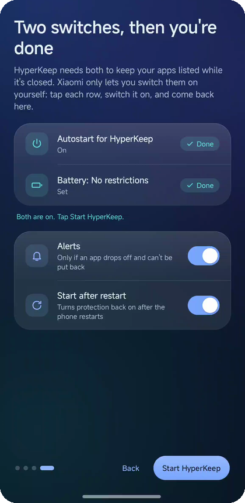

<p align="center">
  
</p>

<h1 align="center">HyperKeep</h1>

<p align="center">
  <b>Get your Xiaomi notifications on time.</b><br>
  For Xiaomi, Redmi and POCO phones on the <b>China ROM</b> of HyperOS.<br>
  Keeps WhatsApp, Messenger, Gmail and your other apps delivering on time, with nearly zero battery drain.
</p>

<p align="center">
  <a href="https://github.com/adnansiddiqui-dev/HyperKeep/releases/latest"></a>
  
  
  
</p>

<p align="center">
  <a href="https://hyperkeep.vercel.app"><b>Website</b></a>
  &nbsp;·&nbsp; <a href="https://hyperkeep.vercel.app/download"><b>Download the APK</b></a>
  &nbsp;·&nbsp; <a href="#set-up-in-one-minute">Setup</a>
  &nbsp;·&nbsp; <a href="#faq">FAQ</a>
</p>

<div align="center">

https://github.com/user-attachments/assets/77b4b7dc-0c76-474c-b8ba-0e2a33f31f1f

<sub>A real recording of the first-time setup on HyperOS 4, with taps and narration (68 seconds).<br>
Turn the sound on for the spoken guide. Can't play it here? <a href="assets/hyperkeep-setup.mp4">Open the video file</a>.</sub>

</div>

---

## Why your messages arrive late

On the China ROM, HyperOS **freezes apps you aren't using** to save battery. A frozen app can't
receive anything, so WhatsApp waits, Gmail waits, and everything arrives at once when you pick up
your phone.

Xiaomi keeps a hidden list of apps it never freezes, but it **rewrites that list** whenever you
install an app or change a battery setting, and drops anything it didn't choose. **Google Play
services**, which delivers most apps' notifications, gets no switch to stay on that list at all.

## The usual fixes cost battery

| What people usually do | What it costs | With HyperKeep |
|---|---|---|
| Set every chat app to **No restrictions** | Each app may skip Android's Doze and run in the background all day | Your apps stay on **Battery saver (recommended)**. Only HyperKeep needs No restrictions |
| **Lock apps in Recents** | A locked app stays running and holds memory all the time | Nothing to lock. HyperKeep even reminds you to unlock kept apps |
| Install a **keep-alive app** | Checking on a timer costs battery whether anything changed or not | HyperKeep sleeps until Xiaomi changes its list, then fixes it in a few milliseconds |

## What HyperKeep does

1. **You choose your apps.** One switch per app. Google Play services is suggested first.
2. **HyperKeep keeps them on Xiaomi's list,** and puts them back within about 2 seconds whenever
   Xiaomi removes them. Then it asks Google Play services to reconnect.
3. **Messages arrive on time,** while everything stays on Battery saver.

It also tells you exactly what to tap when something gets in the way: an app's **Autostart** is
off, an app is set to **No restrictions**, or an app is **locked in Recents**. Xiaomi only lets you
change those yourself, so HyperKeep opens the right page.

## Nearly zero battery drain

Measured on a real China ROM phone with HyperOS 4:

- **Nothing runs in the background.** Android wakes HyperKeep only when Xiaomi changes its list.
- **Under 35 ms** of work each time, then it sleeps again.
- **About 2 seconds** from Xiaomi removing an app to HyperKeep putting it back.
- **One setting changed**, and backed up first.

Details: [Battery & performance](docs/BATTERY.md).

## Screenshots

<p align="center">
  
  &nbsp;
  
  &nbsp;
  
</p>

## Is your phone on the China ROM?

Open **Settings → About phone** and look at the HyperOS version, for example `OS4.0.6.0.XPKCNXM`.
If the letters near the end include **CN**, it's the China ROM. That includes phones imported from
China and China-only models such as the Redmi K series.

HyperKeep works on **HyperOS 1, 2, 3 and 4** with **Android 12 to 17**. Every release is tested on
a real China ROM phone. It isn't built for Global, EEA or India ROMs.

## Set up in one minute

1. **Download** the APK from the [website](https://hyperkeep.vercel.app/download) or
   [Releases](https://github.com/adnansiddiqui-dev/HyperKeep/releases/latest) on your phone and open
   it. Allow installing from your browser if asked.
2. **Open HyperKeep.** Xiaomi first shows its own **Review permissions** list. Only the first two
   matter: **Access list of installed apps** and **Modify system settings**. Leave the rest off
   and tap **OK**.
3. **Turn on HyperKeep's two switches.** Each opens the right Xiaomi page and turns to *Done* when
   you come back:
   - **Autostart for HyperKeep**
   - **Battery: No restrictions** (only HyperKeep needs this; your other apps stay on Battery saver)
4. **Choose your apps** on the home screen, starting with **Google Play services**, then WhatsApp,
   Messenger, your mail app and so on.

**Updates:** about once a day HyperKeep checks for a new version, even when it's closed, and
shows a notification when one is out (or tap **⟳** on Home). Tap **Update** and confirm in
Xiaomi's installer. Your apps, settings and permissions stay.

Full walkthrough: [User guide](docs/USER_GUIDE.md).

## FAQ

<details>
<summary><b>Does HyperKeep drain the battery?</b></summary>

No. It sleeps until Xiaomi changes its list, and each fix takes a few milliseconds. In a 10-minute
screen-off test it used no measurable battery. Most phones use less battery overall, because your
apps can stay on Battery saver instead of No restrictions.
</details>

<details>
<summary><b>Do I still need "No restrictions" or Recents locks for my apps?</b></summary>

No. Only HyperKeep itself needs No restrictions. A Recents lock keeps an app running all the time
for nothing. HyperKeep shows a tip if a kept app has either one.
</details>

<details>
<summary><b>Is it safe? What can HyperKeep change?</b></summary>

HyperKeep changes exactly one Xiaomi setting: its list of apps that are never frozen. It keeps every
entry Xiaomi put there, re-reads the setting after each change, and backs up the original value so
you can restore it. It has no ads, no analytics and no account, and goes online only to check for its
own updates. See [Permissions & privacy](docs/PERMISSIONS.md) and [Safe to install](#safe-to-install).
</details>

<details>
<summary><b>Why does Xiaomi show a long permission list when I first open it?</b></summary>

That screen is Xiaomi's. To edit Xiaomi's list without root, HyperKeep is built for an older Android
version, and HyperOS shows that review screen for such apps. Only the first two switches matter.
</details>

<details>
<summary><b>Do I need root, Shizuku or Developer options?</b></summary>

No. HyperKeep is a single app, set up from normal settings pages.
</details>

<details>
<summary><b>Some notifications are still late at night. Why?</b></summary>

Being on Xiaomi's list stops HyperOS's routine freezing. A few limits, such as HyperOS's deeper
sleep at night, are outside any app's control. HyperKeep makes late notifications much rarer.
</details>

<details>
<summary><b>Why isn't it on Google Play?</b></summary>

Google Play requires a recent target Android version, which would stop HyperKeep from editing
Xiaomi's list without root. So it's published here as an APK, signed with the same key for every
release.
</details>

More answers on the [website](https://hyperkeep.vercel.app/faq).

## Safe to install

Every release is checked before it's published, and you can check it yourself:

- **Scanned for malware.** Each APK is scanned by [VirusTotal](https://www.virustotal.com)'s
  antivirus engines; the release notes link to its report.
- **No trackers.** Each APK is checked against every tracker signature from
  [εxodus Privacy](https://reports.exodus-privacy.eu.org/en/trackers/). A release with a tracker in it
  isn't published.
- **Always the same signing key.** Every release is signed with one key, so only a genuine update can
  replace an installed HyperKeep. Its certificate's SHA-256 fingerprint:

  ```
  B5:06:E4:AF:DC:21:32:72:BD:5A:36:BF:CC:AB:F4:86:40:77:40:99:B7:52:31:BA:32:14:73:D6:26:40:AE:28
  ```

  Compare it with the free, open-source [AppVerifier](https://github.com/soupslurpr/AppVerifier) app,
  or with `apksigner verify --print-certs HyperKeep-vX.Y.Z.apk` on a computer.
- **Files that can't be swapped.** From v1.0.2, releases are immutable: once published, an APK can't
  be replaced. GitHub signs a record of each one; check a download with
  `gh release verify-asset vX.Y.Z HyperKeep-vX.Y.Z.apk -R adnansiddiqui-dev/HyperKeep`.
- **Checked updates.** Each release lists its APK's SHA-256, and HyperKeep checks the size, checksum
  and signature of every update before Android installs it.

HyperKeep is free; see the [license](LICENSE).

## Feedback

Found a bug, or a phone it doesn't work on? Open an
[issue](https://github.com/adnansiddiqui-dev/HyperKeep/issues) with your phone model and HyperOS
version (Settings → About phone).

## Developer

Made by **Adnan Siddiqui** ·
[adnansiddiqui.dev](https://adnansiddiqui.dev) ·
[LinkedIn](https://www.linkedin.com/in/adnansiddiqui-dev/) ·
[Facebook](https://www.facebook.com/adnansiddiqui.dev)

---

<sub>HyperKeep is free to use under its [license](LICENSE). Xiaomi, Redmi, POCO, HyperOS and
Google Play are trademarks of their owners; HyperKeep is not affiliated with them.</sub>
